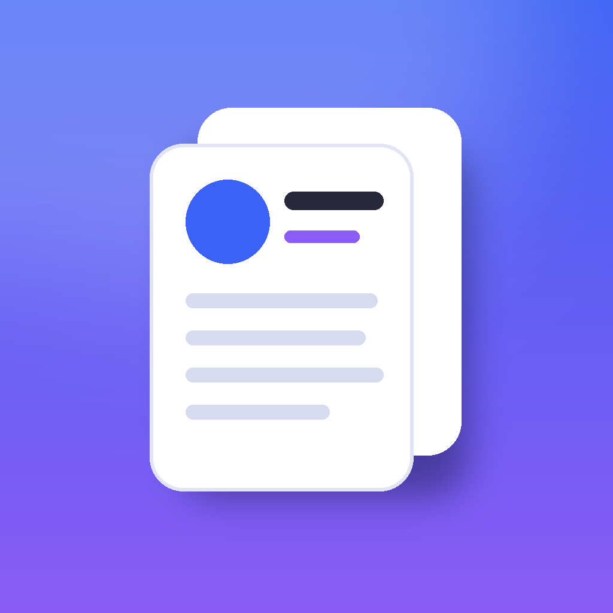
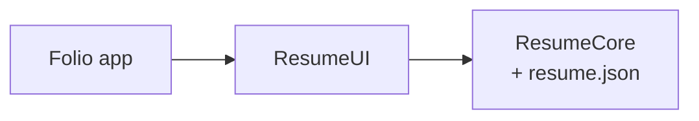

<p align="center">
  
</p>

<h1 align="center">Folio</h1>

<p align="center">
  My résumé as an iPhone app: who I am, what I've done, and every app I've built with screenshots and links to the code.
  It also writes a one-page PDF CV from the same data.
</p>

<p align="center">
  
  
  
  
  
  
  
</p>

---

## Features

- **Profile** — photo, title, location and availability, one-tap email, Upwork, LinkedIn and GitHub, an About section, skills grouped by area, and languages.
- **Download CV** — a one-page A4 PDF drawn by SwiftUI from the same data and shared with the system share sheet, ready to attach to a proposal.
- **History** — experience and education on a timeline, with what's still going on marked in green.
- **Projects** — every app with its icon, tagline and main technologies. Filter by a technology ("show me everything with UIKit"), open a project for screenshots, highlights and the code on GitHub without leaving the app.
- **Light, Dark or System**, remembered between launches; a floating glass tab bar; haptics on selection; VoiceOver labels on every card.

## Everything comes from one JSON file

The app has no text of its own. Name, links, skills, jobs and projects all live in
[`resume.json`](Packages/FolioKit/Sources/ResumeCore/Resources/resume.json); screenshots and icons are in the asset catalog under the names the file uses.
Updating the résumé means editing that file: no Swift to touch.

The tests guard it: the shipped file must decode, pass `ResumeRules.problems(in:)` (valid email, https links, GitHub repositories, real colors, no period that ends before it starts) and contain no phone number, because the repository is public.

## Architecture



| Module | What's inside |
|---|---|
| `ResumeCore` | The résumé's `Codable` types, `ResumeLoader` (with readable errors such as "profile.title: missing"), and `ResumeRules`: periods, technology ranking, filtering, `mailto:` links, CV file names, hex colors and validation. Foundation only. |
| `ResumeUI` | `ResumeViewModel` (`@Observable`), the screens, a `Layout`-based `FlowLayout` for chips, and `CVExporter`, which renders `CVDocumentView` into a PDF with `ImageRenderer`. |

### Key decisions

- **Data, not code.** Content is JSON so it can change without a release of the logic, and so it can be validated in CI like code.
- **One source for app and PDF.** The CV is a SwiftUI view rendered to PDF, so the app and the document can never disagree.
- **Testable layout.** `FlowLayout` computes frames in a pure static function; the `Layout` methods only apply them.
- **Privacy first.** No phone number anywhere; contact goes through email and professional profiles.

## Requirements

- Xcode 16 or later, iOS 17 or later
- [XcodeGen](https://github.com/yonaskolb/XcodeGen) (`brew install xcodegen`)

## Getting started

```bash
git clone https://github.com/Irenapoghosian/folio-resume.git
cd folio-resume
xcodegen
open Folio.xcodeproj
```

Press **⌘R** to run, or **⌘U** to run the tests.

## Testing

**27 unit tests**, run on every push by GitHub Actions together with SwiftLint in strict mode. The coverage badge counts logic files; SwiftUI screens are checked by running the app.

- `ResumeLoaderTests` — the shipped résumé loads, is valid and has no phone number; optional fields; readable errors for broken files.
- `ResumeRulesTests` — periods, technology ranking, featured-first filtering, `mailto:` encoding, CV file names, hex colors, validation messages.
- `ResumeViewModelTests` — filtering and clearing, counts, writing the CV once, recovering from a failed export.
- `FlowLayoutTests`, `ThemeTests`, `CVExporterTests` — wrapping rows, appearances, and a real one-page A4 PDF.

## Author

**Irina Poghosyan** — iOS developer · [GitHub](https://github.com/Irenapoghosian) · [Upwork](https://www.upwork.com/freelancers/~0139800b5b7c88c3b6) · [LinkedIn](https://www.linkedin.com/in/irina-poghosyan-6811b2216/)

## License

MIT. See [LICENSE](LICENSE). The photo and screenshots are mine and not covered by the license.
